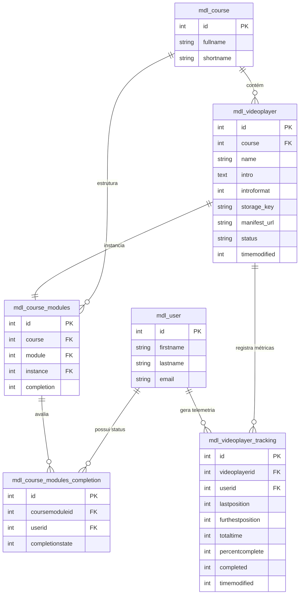

O mapeamento do modelo de dados para a sua monografia divide-se entre as **tabelas nativas do Moodle** com as quais a solução se integra e as **tabelas customizadas do módulo (`mod_videoplayer`)**.

---

### 1. Entidades Nativas do Moodle (Core Integrado)

| Entidade / Tabela | Descrição e Papel na Solução | Campos-Chave Relacionados |
| --- | --- | --- |
| **`mdl_user`**  | Entidade de usuários (alunos e professores). Identifica quem consome o vídeo e quem gerencia a atividade.

 | `id`, `firstname`, `lastname`, `email`  |
| **`mdl_course`**  | A unidade curricular onde a atividade de vídeo é instanciada.

 | `id`, `fullname`, `shortname`  |
| **`mdl_course_modules`**  | Registra a instância da atividade dentro da grade do curso e controla as regras de conclusão nativa.

 | `id`, `course`, `module`, `instance`, `completion`  |
| **`mdl_course_completion_criteria`** | Define as regras de conclusão configuradas para o curso/módulo.

 | `id`, `course`, `moduleinstance` |
| **`mdl_course_modules_completion`** | Armazena o estado de conclusão da atividade por aluno (disparado quando $\ge 80\%$).

 | `id`, `coursemoduleid`, `userid`, `completionstate`  |
| **`mdl_context`**  | Define o escopo de segurança/RBAC no nível do módulo.

 | `id`, `contextlevel`, `instanceid`  |

---

### 2. Entidades Customizadas do Plugin (`mod_videoplayer`)

#### A. Configuração da Atividade (`mdl_videoplayer`)

Armazena os parâmetros pedagógicos da instância e o ponteiro direto para o manifesto HLS no Blob Storage.

| Coluna | Tipo | Nulo | Default | Descrição / Papel |
| --- | --- | --- | --- | --- |
| **`id`**  | INT(10) PK | Não | *Auto* | Identificador único da instância.

 |
| **`course`**  | INT(10) FK | Não | - | Chave estrangeira para `mdl_course.id`.

 |
| **`name`**  | VARCHAR(255) | Não | - | Título da videoaula exibido no curso.

 |
| **`intro`**  | TEXT | Sim | NULL | Descrição ou orientações pedagógicas.

 |
| **`introformat`**  | INT(4) | Não | 0 | Formato do texto da introdução (HTML, Markdown, etc.).

 |
| **`storage_key`**  | VARCHAR(255) | Sim | NULL | Identificador/caminho do arquivo bruto original no Bucket de Ingestão.

 |
| **`manifest_url`**  | VARCHAR(512) | Sim | NULL | URI/URL direta do manifesto `master.m3u8` no Object Storage.

 |
| **`status`**  | VARCHAR(30) | Não | `'PENDING'` | Estado do pipeline (`PENDING`, `PROCESSING`, `READY`, `ERROR`).

 |
| **`timemodified`**  | INT(10) | Não | 0 | Timestamp da última alteração de configuração.

 |

#### B. Telemetria e Rastreamento Individual (`mdl_videoplayer_tracking`)

Registra os eventos e métricas de consumo por estudante, validando progresso e prevenindo fraudes (*anti-cheat*).

| Coluna | Tipo | Nulo | Default | Descrição / Papel |
| --- | --- | --- | --- | --- |
| **`id`**  | INT(10) PK | Não | *Auto* | Identificador único do registro de telemetria.

 |
| **`videoplayerid`**  | INT(10) FK | Não | - | Chave estrangeira para `mdl_videoplayer.id`.

 |
| **`userid`**  | INT(10) FK | Não | - | Chave estrangeira para `mdl_user.id`.

 |
| **`lastposition`**  | INT(10) | Não | 0 | Último segundo reproduzido (utilizado no *Resume Playback*).

 |
| **`furthestposition`**  | INT(10) | Não | 0 | Ponto máximo contínuo assistido (bloqueia fraudes de *seek*).

 |
| **`totaltime`**  | INT(10) | Não | 0 | Tempo total líquido assistido (em segundos).

 |
| **`percentcomplete`**  | INT(3) | Não | 0 | Porcentagem válida calculada ($0$ a $100$).

 |
| **`completed`**  | INT(1) | Não | 0 | Flag indicativa de conclusão ($0$ = Não, $1$ = Sim).

 |
| **`timemodified`**  | INT(10) | Não | 0 | Timestamp do último ping/beacon recebido.

 |

* **Restrição de Unicidade / Índice:** `UNIQUE KEY (videoplayerid, userid)`.

---

### 3. Diagrama Entidade-Relacionamento (ERD)

